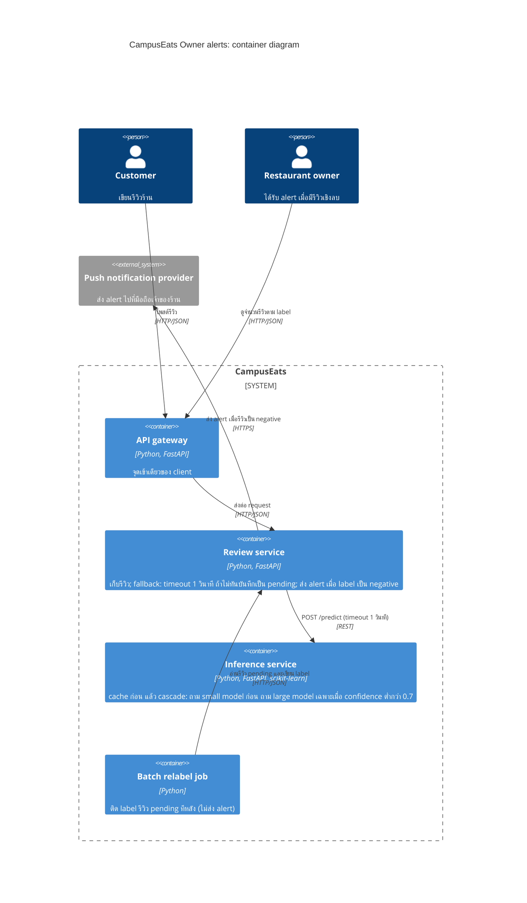

# Task 4: Deployment topologies and trade-offs

**Name / ชื่อ: ณภัทร เสรีรักษ์**

**Student ID / รหัสนิสิต: 6632061321**

This is **individual work**: each student completes and submits their own copy, in their own fork.

_งานนี้เป็น**งานเดี่ยว** นิสิตแต่ละคนทำและส่งงานของตัวเอง ใน fork ของตัวเอง_

**Scenario (A, B or C) / Scenario ที่เลือก:** A (Owner alerts: แจ้งเตือนเจ้าของร้าน)

Choose **one** scenario below. If the last digit of your student ID is odd, take A or B; if it is even, take B or C. Use your measurements from Tutorial 6 as evidence: cite run names from `results/runs.csv`. Answer in Thai or English.

เลือก scenario **หนึ่ง** ข้อด้านล่าง ถ้าเลขตัวสุดท้ายของรหัสนิสิตเป็นเลขคี่ ให้เลือก A หรือ B ถ้าเป็นเลขคู่ ให้เลือก B หรือ C ใช้ผลการวัดจาก tutorial ที่ทำไปเป็นข้อมูลอ้างอิง โดยอ้างชื่อ run จาก `results/runs.csv` จะตอบเป็นภาษาไทยหรือภาษาอังกฤษก็ได้

Facts that hold in every scenario / ข้อเท็จจริงที่ใช้กับทุก scenario:

- The large model serves at most **20 calls per second** (4 calls at once × about 200 ms each), and every call costs money.

  _large model รับได้สูงสุด **20 calls ต่อวินาที** (พร้อมกัน 4 calls × ประมาณ 200 ms ต่อ call) และทุก call มีค่าใช้จ่าย_

- The small model is fast and cheap enough to run anywhere, including inside the review service or on a kiosk, but it is much less accurate on its own.

  _small model เร็วและถูกพอที่จะรันที่ไหนก็ได้ รวมถึงภายใน review service หรือบน kiosk แต่ถ้าใช้ตัวเดียวจะแม่นน้อยกว่ามาก_

## Scenarios

**A. Owner alerts.** When a customer posts a negative review, the restaurant owner gets a push notification within **2 seconds**. At the lunch peak, CampusEats receives **40 reviews per second**. A missed alert is acceptable, but a wrong alert (for example, "your customer is unhappy" when they are happy) makes owners stop trusting alerts and, in the end, ignore them.

_เมื่อลูกค้าโพสต์รีวิวเชิงลบ เจ้าของร้านจะต้องได้รับ push notification ภายใน **2 วินาที** เวลาช่วงพีคตอนเที่ยง CampusEats ได้รับรีวิวจำนวน **40 รายการต่อวินาที** การพลาด alert ไปบ้างนั้นยอมรับได้ แต่ alert ที่ผิด (เช่น "ลูกค้าไม่พอใจ" ทั้งที่จริงๆ แล้วพอใจ) จะทำให้เจ้าของร้านไม่เชื่อถือและเลิกสนใจ alert ในที่สุด_

**B. Canteen kiosk.** A tablet in each canteen lets students leave a review on the spot. However, the canteen Wi-Fi is poor: the tablets lose their connection several times a day, for minutes at a time. The system must accept every review, even while a tablet is offline. Restaurant owners need the labels **by the end of the day**.

\*มี tablet ในแต่ละโรงอาหารให้นิสิตรีวิวได้ทันที อย่างไรก็ดี การเชื่อมต่อ Wi-Fi ในโรงอาหารไม่ดี ทำให้ tablet หลุดการเชื่อมต่อวันละหลายครั้ง ครั้งละหลายนาที ระบบจะต้องรับรีวิวได้ทุกรายการแม้ขณะที่กำลัง offline อยู่ และเจ้าของร้านต้องการ label **ภายในสิ้นวัน\***

**C. Weekly report.** Restaurant owners want a weekly sentiment report. Nothing in producing this report has to be real-time. **Accuracy matters most** and **cost must be minimal**.

\*เจ้าของร้านต้องการรายงาน sentiment รายสัปดาห์ ไม่มีอะไรที่จะต้องทำแบบ real-time ในการออกรายงานนี้ ความแม่นยำ **(accuracy) สำคัญที่สุด** และ **ค่าใช้จ่ายต้องน้อยที่สุด\***

## Topologies and patterns to choose from / Topology และ pattern ที่เลือกใช้ได้

|     | Topology                        | Where the model runs / โมเดลรันที่ไหน                                                                                                           |
| --- | ------------------------------- | ----------------------------------------------------------------------------------------------------------------------------------------------- |
| T1  | Model as a service, synchronous | Inference service, called for each review (today's baseline) _inference service ถูกเรียกทุกรีวิว (baseline ของวันนี้)_                       |
| T2  | Model as a library              | Inside the review service, or on the device _ภายใน review service หรือบนอุปกรณ์_                                                             |
| T3  | Hybrid                          | Small model locally, large model as a remote service _small model รันในเครื่อง large model เป็น remote service_                              |
| T4  | Asynchronous / batch            | Reviews are queued (broker, W10) or stored, and scored later in bulk _รีวิวถูกเข้าคิว (broker, W10) หรือเก็บไว้ แล้วติด label ทีหลังเป็นชุด_ |

Combine one topology with any of the patterns from Tutorial 6: **fallback**, **cascade** and **cache**.

\*เลือก topology หนึ่งแบบ แล้วผสมกับ pattern จาก Tutorial 6 ได้ตามต้องการ: **fallback**, **cascade** และ **cache\***

## 1. Quality requirements

The three most important quality requirements for your scenario, each with a number where possible.

_quality requirements ที่สำคัญที่สุด 3 ข้อของ scenario ที่เลือก ระบุตัวเลขเมื่อทำได้_

| #   | Quality                           | Requirement                                                                                                                                                                                           |
| --- | --------------------------------- | ----------------------------------------------------------------------------------------------------------------------------------------------------------------------------------------------------- |
| 1   | Performance (latency)             | เจ้าของร้านได้ alert รีวิวเชิงลบภายใน 2 วินาที และ 95% ของรีวิวได้ label ภายใน 1 วินาที (QR1) เมื่อมี 10 requests พร้อมกัน                                                                            |
| 2   | Capacity / cost                   | ช่วงพีคตอนเที่ยงมี 40 รีวิวต่อวินาที แต่ large model รับได้ไม่เกิน 20 calls ต่อวินาที ดังนั้นรีวิวไม่เกิน 50% ถึงจะส่งไปที่ large model ได้ (QR4, QR5)                                                |
| 3   | Accuracy (ใช้แทน alert precision) | label ถูกต้องอย่างน้อย 90% (QR3) เพราะ alert ที่ผิดทำให้เจ้าของร้านเลิกสนใจ alert ทั้งหมด ส่วน alert ที่พลาดไปบ้างยอมรับได้ (เครื่องมือวัดได้แค่ accuracy รวม ไม่ได้แยก precision ของ label negative) |

## 2. Design / การออกแบบ

Your topology, the patterns you add, and a container-level diagram (C4 level 2). The C4 diagram must be written in Mermaid.

_topology ที่เลือก pattern ที่เพิ่ม และ diagram ระดับ container (C4 level 2) เขียนด้วย Mermaid_

Topology: **T1 (model as a service, synchronous)** ผสม pattern **cascade**, **cache** และ **fallback** เพิ่มเข้าไปใน services ที่มีอยู่

- small model ตอบรีวิวที่มั่นใจ ส่งเฉพาะรีวิวที่ไม่มั่นใจไปที่ large model
- ข้อความที่ซ้ำตอบจาก cache
- รีวิวที่ large model ตอบไม่ทันใน 1 วินาทีจะถูกบันทึกเป็น `pending` และเราจะไม่ส่ง alert

## 3. Evidence / หลักฐาน

Which runs support your choice? Show the numbers and, for scenario A, the capacity arithmetic: how many large-model calls per second does your design need at the peak?

_run ไหนที่สนับสนุนการตัดสินใจของนิสิต ให้นิสิตแสดงตัวเลขประกอบ และสำหรับ scenario A ให้นิสิตแสดงการคำนวณ capacity ด้วย เพื่อแสดงว่าในช่วงพีคนั้น design ของนิสิตต้องใช้ large model กี่ calls ต่อวินาที_

เราคำนวณ capacity ช่วงพีคจากสูตรนี้ (40 รีวิวต่อวินาที, large model รับได้ 20 calls ต่อวินาที):

large calls ต่อวินาที = 40 × สัดส่วนรีวิวที่ไปถึง large model

- ใช้ large อย่างเดียว (`t0-large`, 100%): 40 × 1.00 = **40 calls/s** เกินขีดจำกัดสองเท่า
- cascade 0.7 อย่างเดียว (`t2-0.7`, 53%): 40 × 0.53 = **21.2 calls/s** เกินขีดจำกัดเล็กน้อย
- cascade 0.7 + cache (`t3-cache`, 38%): 40 × 0.38 = **15.2 calls/s** ต่ำกว่า 20 เหลือ margin ประมาณ 24%

| Run                  | What it shows / แสดงอะไร                                                                                                                                       |
| -------------------- | -------------------------------------------------------------------------------------------------------------------------------------------------------------- |
| t0-large             | accuracy 93.5% แต่ large calls 100% = 40 calls/s เกินขีดจำกัด 20 (p50 507 ms)                                                                                  |
| t0-small             | เร็ว (p50 58 ms) และ large calls 0% แต่ accuracy 72.5% ต่ำกว่า 90% มาก จะส่ง alert ผิดเยอะ                                                                     |
| t2-0.7               | accuracy 93.0%, large calls 53% = 21.2 calls/s เกินขีดจำกัดเล็กน้อย cascade อย่างเดียวจึงยังไม่พอ                                                              |
| t2-0.6               | large calls 38% = 15.2 calls/s แต่ accuracy 91.5% ใกล้เส้น 90% จึงมี margin น้อย                                                                               |
| t3-cache             | accuracy 93.0%, large calls 38% = 15.2 calls/s, cache hits 35%, p95 551 ms (ผ่านทั้ง 1 s และ 2 s)                                                              |
| t4-final             | design สุดท้ายรวมกัน (cascade 0.7 + cache + large ค้าง 10%): errors 0, pending 11, accuracy 93.1%, large calls 38% = 15.2 calls/s, p95 1010 ms, run time 4.0 s |
| t1-before / t1-after | large model ค้าง: errors 18, run time 26.5 s หลังเพิ่ม fallback: errors 0, pending 22 (ไม่ส่ง alert ซึ่งยอมรับได้), run time 9.9 s, p95 1024 ms                |

`t1-after` มี p95 1024 ms เกิน QR1 (1 วินาที) เล็กน้อย และ `t4-final` ก็ใกล้เคียงกัน (1010 ms) เพราะรีวิวที่ pending ใช้เวลารอ timeout 1 วินาทีพอดี และมีมากกว่า 5% ของ requests (11 จาก 200) ค่า p95 จึงไปอยู่ที่เวลา timeout แต่ยังต่ำกว่าเวลา alert 2 วินาทีมาก และไม่มี errors

เราจึงเลือก cascade 0.7 + cache + fallback เพราะ `t4-final` ซึ่งวัด design รวมกันจริงภายใต้ large model ค้าง ให้ errors 0, accuracy 93.1% และ large calls 38% (15.2 calls/s ต่ำกว่า 20)

## 4. ADR

Use the ADR format from W5.

_ใช้รูปแบบ ADR จาก W5_

**Title:** ใช้ model as a service ร่วมกับ cascade, cache และ fallback สำหรับ alert เจ้าของร้าน

**Status:** Proposed

**Context:**

เจ้าของร้านต้องได้ alert รีวิวเชิงลบภายใน 2 วินาที ช่วงพีคตอนเที่ยงมี 40 รีวิวต่อวินาที แต่ large model รับได้สูงสุด 20 calls ต่อวินาที และทุก call มีค่าใช้จ่าย

alert ที่ผิดทำให้เจ้าของร้านเลิกสนใจ alert ส่วน alert ที่พลาดไปบ้างยอมรับได้

จากการวัด large model แม่น (`t0-large`, 93.5%) แต่ต้องส่งทุกรีวิวไปที่ large (40 calls/s) ส่วน small model ตัวเดียวแม่นน้อยเกินไป (`t0-small`, 72.5%)

**Decision:**

เราเลือกใช้ topology T1 (inference service แบบ synchronous) และเพิ่ม 3 pattern:

- cascade ที่ threshold 0.7 (ถาม small model ก่อน)
- cache สำหรับข้อความรีวิวที่ซ้ำ
- timeout 1 วินาทีพร้อม fallback เป็น `pending`

เราจะส่ง alert เฉพาะรีวิวที่มี label ส่วนรีวิว pending ให้ batch job ติด label ทีหลัง

**Consequences:**

- ข้อดี:
  - ช่วงพีคใช้ large model ประมาณ 15.2 calls ต่อวินาที (`t3-cache`, 38% ของ 40/s) ต่ำกว่าขีดจำกัด 20 calls/s
  - accuracy คงที่ 93.0% (เกิน 90%)
  - p95 อยู่ที่ 551 ms ซึ่งอยู่ในเวลา 2 วินาที
  - เมื่อ large model ค้างจะไม่เกิด errors อีก (`t1-after`: errors 0, pending 22)
  - design รวมกันภายใต้ large ค้าง 10% (`t4-final`): errors 0, pending 11, accuracy 93.1%
- ข้อเสีย:
  - accuracy ต่ำกว่าการใช้ large อย่างเดียวประมาณ 0.5 จุด (93.0% เทียบกับ 93.5%) และ small model อาจมั่นใจแต่ผิดได้
  - margin ขึ้นกับ cache hit rate (35% ในการทดสอบ) ถ้ารีวิวซ้ำน้อยลง ความต้องการจะกลับไปใกล้ 21.2 calls/s (`t2-0.7`)
  - รีวิว pending จะไม่ได้ alert
  - เราต้องล้าง cache ทุกครั้งที่เปลี่ยน large model
  - ตัวเลข 15.2 calls/s คำนวณจากสัดส่วนใน load test
  - p95 ประมาณ 1,010 ms (`t4-final`) เกิน 1 วินาทีเล็กน้อย เพราะรีวิวที่ pending รอ timeout 1 วินาที แต่ยังอยู่ใน 2 วินาที
  - วัดได้แค่ accuracy รวม ไม่ได้วัด precision ของ alert (เฉพาะ label negative)

**Alternatives considered:** at least one topology you rejected, and why.

_อย่างน้อยหนึ่ง topology ที่ไม่เลือก และเหตุผล_

> **T1 ใช้ large model อย่างเดียว:** เราไม่เลือกเพราะช่วงพีคต้องใช้ 40 calls/s (`t0-large`) เกินขีดจำกัด 20 calls/s สองเท่า และค่าใช้จ่ายสูงที่สุด
>
> **T2 ใช้ small model อย่างเดียว (เป็น library):** เราไม่เลือกเพราะแม้จะเร็ว (p50 58 ms) และแทบไม่มีค่าใช้จ่าย แต่ accuracy 72.5% (`t0-small`) ทำให้ alert ผิดเยอะและเจ้าของร้านเลิกสนใจ
>
> **T3 hybrid (small model อยู่ใน review service, large เป็น remote service):** เราไม่เลือกเพราะเรายังไม่ได้วัด และ small model ตอบเร็วกว่า 1 ms อยู่แล้ว การย้ายมาไว้ใน review service จึงประหยัดแค่ network hop เล็กน้อย แต่ต้องดูแลและ deploy model สองที่
>
> **T4 แบบ asynchronous/batch:** เราไม่เลือกเพราะทำ alert ภายใน 2 วินาทีไม่ได้ จึงใช้เฉพาะกับรีวิวที่ pending
